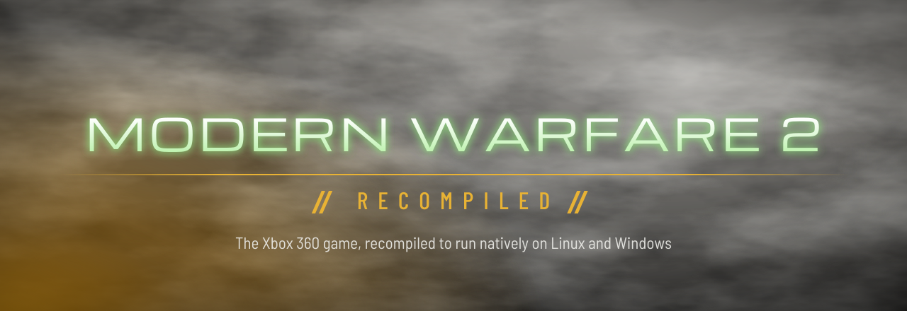
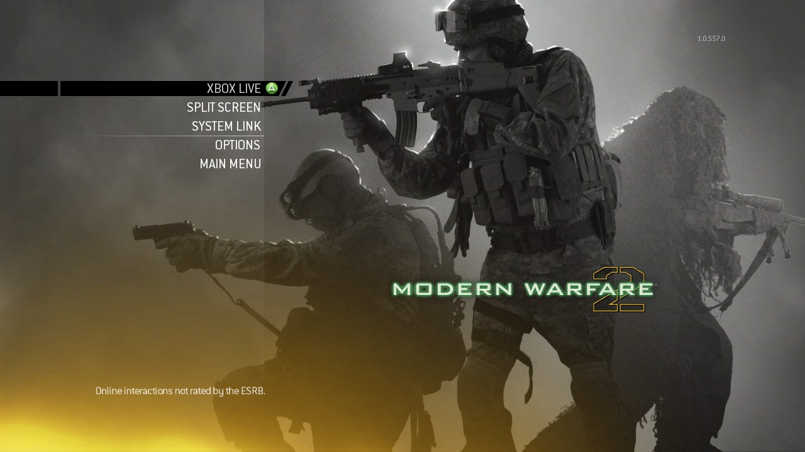
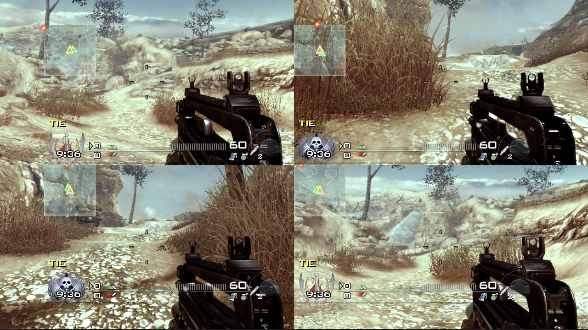
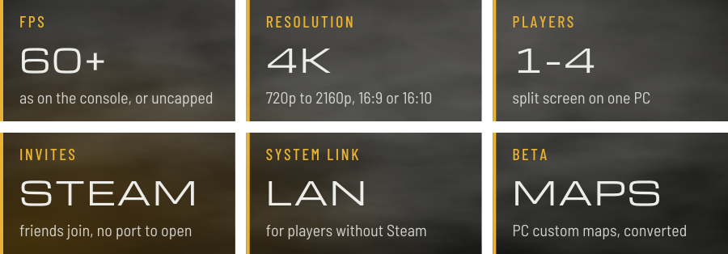

  

  <b>Call of Duty: Modern Warfare 2 (2009) for the Xbox 360, running natively on Linux and Windows.</b> 
  Not an emulator: the game's executables are recompiled ahead of time. 
  No game files are included. You need your own disc.

  

<table>
  <tr>
    <td width="50%"></td>
    <td width="50%"></td>
  </tr>
</table>

- **Campaign and multiplayer**, with split screen for up to four controllers.
- **Online with friends**: private matches and system link, through Steam invites or on your local network.
- **Sharper than the console**: any window size or fullscreen; drawn at 720p, 1080p, 1440p or 4K, in 16:9, 16:10 or 4:3 (down to 640x480 for a CRT TV); antialiasing up to 8x; 16x texture filtering; sharper shadows; wider field of view.
- **Your profiles**: set your rank and prestige, unlock everything, open any mission.
- **Custom maps (beta)**: maps made for the PC game, converted by the launcher.
- **Xbox 360-style controllers**, with rumble.

Not supported: ranked playlists and matchmaking without a [server](#online), and moving a match to another host when its host leaves.

| You need | |
|---|---|
| **Game** | an ISO of the Xbox 360 disc, version 1.0.557 (USA/Europe). The launcher checks it and downloads title update 6 itself. |
| **System** | Linux or Windows, 64-bit, with a processor that has SSE4.2 (Intel since 2008, AMD since 2011) |
| **Graphics** | Vulkan 1.2 |
| **Disk** | 8 GB |
| **Controller** | required to play; the keyboard covers the menus |

1. **Download** it for your system from the [releases](../../releases/latest), and extract it anywhere.
2. **Install**: start `mw2-launcher`, choose INSTALL GAME and pick your ISO. The game is copied into `game/` and updated to title update 6.
3. **Play**: PLAY CAMPAIGN or PLAY MULTIPLAYER. (`mw2-sp` and `mw2-mp` start the game directly.)

| Screen | |
|---|---|
| **PROFILES** | rename yourself or switch profile; set the multiplayer rank and prestige; unlock everything; open the campaign's and Special Ops' missions |
| **GRAPHICS** | fullscreen, aspect ratio, resolution, stretching, antialiasing, texture filtering, shadows, frame rate limit and field of view (below) |
| **NETWORK** | how the multiplayer reaches other players: NONE (this PC only), LAN, SERVER or STEAM ([below](#online)) |
| **MAPS** *(beta)* | ADD MAP converts a map made for the PC game (IW4x). It then shows in a private match under BONUS MAPS. PC GAME points at your copy of the PC game, which such maps borrow pictures and sounds from; it is found on Steam by itself. Some maps don't convert yet, and some that do don't play. |
| **CHECK FOR UPDATES** | installs a newer release over this one |
| **REPORT A BUG** | runs the game once with its log kept, writes a report and opens a new issue with your system filled in |

| Graphics | As on the console | Also |
|---|---|---|
| FULLSCREEN | | `F8` in the game |
| ASPECT RATIO | 16:9 | 16:10, 4:3 |
| RESOLUTION | 720p | 1080p, 1440p, 4K, or their 16:10 sizes (faster graphics cards); 640x480 to 2880x2160 in 4:3 |
| STRETCH | off, black bars on a screen of another shape | on, the picture fills it (for a CRT TV) |
| ANTIALIASING | 2x | 4x, 8x, off |
| ANISOTROPY | 1x to 4x | 2x to 16x at least (sharper ground and walls at a slant) |
| SHADOWS | console | 2x, 3x, 4x (smoother shadow edges; faster graphics cards) |
| FPS LIMIT | 60 | higher, or none |
| FOV | 65 | up to 120 |

| Key | Does |
|---|---|
| arrows, `Enter`, `Esc` | d-pad, Start, Back |
| `Z` `X` `C` `V` | A B X Y |
| `Q` `E` | bumpers |
| `F8` | fullscreen |
| `F6` | invite friends |
| `Home` | the guide (the controller's Guide button): what you are playing, friends, quit |

Everyone runs `mw2-mp` from the same release, with the same NETWORK chosen in the launcher.

**Steam.** With Steam running, the game shows as *Spacewar*. SYSTEM LINK lists the games every Steam player hosts, worldwide, and anyone can join yours. For a game among friends, host PLAY ONLINE → PRIVATE MATCH and choose *Invite friends* (or press `F6`): it lists your Steam friends who are playing. Your friend accepts in Steam's chat while their game is running. Other players see your Steam name. Without Steam running, it plays as LAN.

**Server.** Everyone on the same server sees each other's games in SYSTEM LINK, can join each other's private matches, and finds games together with FIND GAME, from anywhere. Whoever hosts a match plays in it. Enter the server's address and password under NETWORK; nobody but the server's owner needs to open a port. To run one, see [docs/relay.md](docs/relay.md).

**LAN.** SYSTEM LINK finds games on the network by itself. In a private match, the lobby's *Invite friends* invites everyone on the network; start the others with `MW2_LAN_ACCEPT=1`. Two copies of `mw2-mp` on one PC can play a system link match, each with the controller that chose SYSTEM LINK in it.

Everyone must have the same release: the launcher updates it. Another release's games don't show in SYSTEM LINK, and joining one says *Server is a different version*.

The known security bugs in the game's 2009 network code are fixed ([docs/security.md](docs/security.md)). It is still old code: play online only with people you trust.

- **Steam**: anyone on Steam can join a SYSTEM LINK game you host, and can reach your game while you host one. While you look for games in SYSTEM LINK, any game listed there can answer. Otherwise the game ignores traffic from anyone not in your lobby, and a private match is always among friends.
- **Server**: anyone on the server can join your games. The server sees all the traffic; the other players don't see your address.
- **LAN**: anyone on the same network can reach the game.

What the launcher sets is kept in a file named `.env` beside the executables, one setting per line. Environment variables work too.

| Setting | |
|---|---|
| `MW2_FULLSCREEN=1` | FULLSCREEN |
| `MW2_RENDER=<w>x<h>`, `MW2_SCALE=<2 or 3>` | ASPECT RATIO and RESOLUTION |
| `MW2_STRETCH=1` | STRETCH |
| `MW2_MSAA=<n>`, `MW2_NO_MSAA=1` | ANTIALIASING |
| `MW2_ANISOTROPY=<2 to 16>` | ANISOTROPY |
| `MW2_SHADOW_SCALE=<2 to 4>` | SHADOWS |
| `MW2_FPS_LIMIT=<n>` | FPS LIMIT; 0 is no limit |
| `MW2_FOV=<65 to 120>` | FOV |
| `MW2_NO_AUDIO=1` | no sound |
| `MW2_LOG_FILE=mw2.log` | keeps the log, to attach to a bug report |

Saves are in `saves/` beside the executables.

Building, the source layout and how the runtime works: [docs/building.md](docs/building.md), [docs/runtime.md](docs/runtime.md), [docs/switches.md](docs/switches.md) and the rest of [docs/](docs/).

[GPL-3.0-only](LICENSE) (`SPDX-License-Identifier: GPL-3.0-only`). It covers this project's own code: the runtime, tools, patches and build files. It grants nothing for the game: Activision's code and data, and the C++ generated from the game's executables, are not part of this repository and not under this license.

No game code or data is included; the builds only run with files from your own disc. Not affiliated with Activision, Infinity Ward, Microsoft or Valve.
